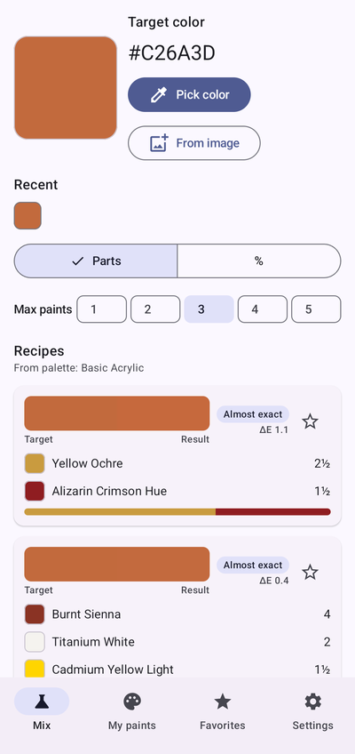
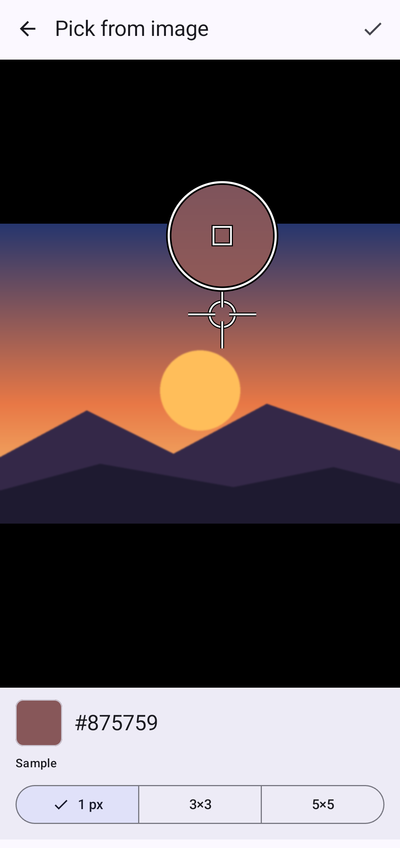
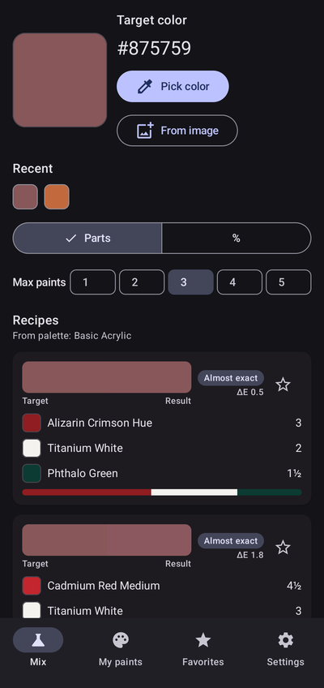
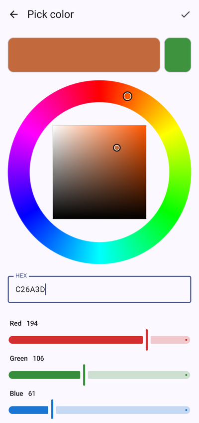
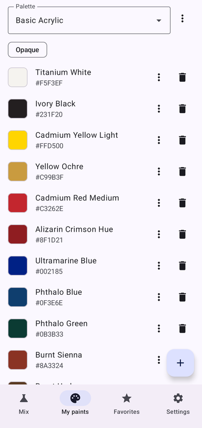
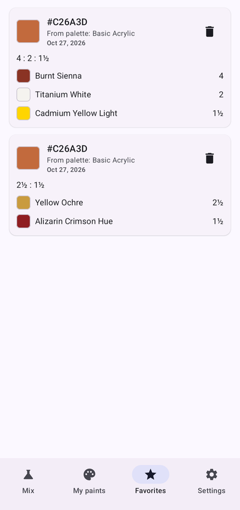
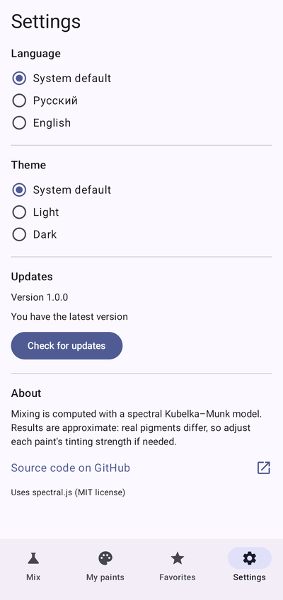

<div align="center">

# ColorStruction

**Tells you which of *your own* paints to mix — and in what proportions — to get the color you want.**

[](https://github.com/IWatman/ColorStruction/releases/latest)
[](https://github.com/IWatman/ColorStruction/actions/workflows/ci.yml)


[](LICENSE)


&nbsp;

&nbsp;


</div>

## Why

Mixing paint is guesswork: you look at a reference, squeeze out a bit of this and a bit of
that, and hope. ColorStruction works the problem backwards. Give it a target color — from a
color wheel, a HEX code or a pixel of a photo — and it searches mixes built only from the
paints **you actually own**, then shows the best recipes with simple proportions and an
honest accuracy estimate.

## Features

| | |
|---|---|
|  | **Pick any color**<br>A hue ring with a saturation/value square, plus HEX input and RGB sliders, all in sync. Recent colors are one tap away. |
|  | **Eyedropper on photos**<br>Take a picture or choose one from the gallery. Pinch to zoom, drag the crosshair, and a magnifier loupe shows exactly which pixels you're sampling (1 px, 3×3 or 5×5, averaged in linear light). |
|  | **Recipes from your paints**<br>Up to 5 paints per recipe, and fewer is preferred. Proportions as parts (`2½ : 1½`) or percentages. Every recipe shows the target next to the predicted result and its color difference (ΔE) *after* rounding — so "1 : 1" really means what it says. |
|  | **Your palettes**<br>Several palettes, each opaque (acrylic, oil, gouache) or watercolor — for watercolor the app lightens with water instead of white. Add paints by color wheel, HEX or a photo of a swatch; tune each paint's tinting strength. |
|  | **Favorite recipes**<br>Star a recipe to keep it. Favorites are snapshots, so editing or deleting paints later doesn't change them. |
|  | **Made to live with**<br>Light, dark or system theme. English and Russian, switchable in the app. Updates install from inside the app. |

## How the mixing works

Averaging RGB values is wrong for paint: blue + yellow averaged in RGB is gray, while real
paint gives green, because pigments *subtract* light. ColorStruction mixes subtractively:

1. Each sRGB color is turned into a reflectance spectrum (38 bands, 380–750 nm) built from
   7 basis spectra — the approach of [spectral.js](https://github.com/rvanwijnen/spectral.js).
2. Spectra become absorption/scattering ratios with the Kubelka–Munk equation
   `K/S = (1 − R)² / 2R`; a mix is the concentration-weighted sum of the K/S curves.
3. The mixed spectrum is converted back to sRGB and compared with the target using
   **CIEDE2000**.
4. The solver tries every combination of 1–3 paints (and 4–5 when needed), optimizes the
   proportions, and prefers fewer paints unless more paints are clearly closer.
5. Proportions are rounded to simple parts only as far as the color stays within ΔE 0.5 of
   the unrounded optimum.

| ΔE | Shown as | Meaning |
|---|---|---|
| < 2 | Almost exact | Indistinguishable for most people |
| 2–5 | Close | A good match |
| 5–10 | Similar | Same kind of color, visibly off |
| > 10 | Can't be mixed | Your paints can't reach this color |

> The model is an approximation — real pigments differ from reconstructed spectra. If a paint
> dominates mixes more than predicted, raise its tinting strength in the paint editor.

## Install

1. Download `ColorStruction-vX.Y.Z.apk` from the
   [latest release](https://github.com/IWatman/ColorStruction/releases/latest).
2. Open it on your phone and allow installing apps from that source.

Later versions install from inside the app: **Settings → Check for updates**. Every release
is signed with the same key, so updates install over the existing app and keep your palettes.

## Build from source

Requirements: JDK 17+ and the Android SDK (platform 35).

```bash
./gradlew testDebugUnitTest   # 200+ JVM unit tests
./gradlew assembleDebug       # app/build/outputs/apk/debug/app-debug.apk
```

Create `local.properties` with `sdk.dir=/path/to/Android/Sdk` if the SDK isn't found.
Release builds are minified with R8 and signed from a `keystore.properties` kept outside the
repository (path in `COLORSTRUCTION_KEYSTORE_PROPERTIES`, default
`~/.colorstruction/keystore.properties`).

### Releasing

Releases are built by GitHub Actions:

1. Bump the default `appVersion` in `app/build.gradle.kts`.
2. Write the notes in `.github/release-notes/vX.Y.Z.md`.
3. `git tag vX.Y.Z && git push origin vX.Y.Z`.

The workflow runs the tests, builds and signs the APK with the key from repository
secrets, verifies the signature and publishes the release.

## Tech stack

Kotlin · Jetpack Compose · Material 3 · Navigation Compose · Room · DataStore ·
Coroutines/Flow · AppCompat per-app locales · JUnit + Robolectric · GitHub Actions

```
app/src/main/java/com/colorstruction/
  color/       color spaces, CIEDE2000, spectral Kubelka–Munk mixing
  mixing/      recipe solver, proportions, starter palette
  data/        Room database (palettes, paints, favorites), settings
  update/      GitHub Releases checker, downloader and installer
  ui/          mix, picker, eyedropper, paints, favorites, settings, theme
```

## Translations

The UI ships in English (default) and Russian. To add a language:

1. Copy `app/src/main/res/values/strings.xml` to `values-<code>/strings.xml` and translate it.
2. Add `<locale android:name="<code>" />` to `app/src/main/res/xml/locales_config.xml`.

## Roadmap

Ideas for after 1.0 — see [PLAN.md](PLAN.md):

- Calibrating a paint from a photo of its swatch
- Exporting and importing palettes
- Sharing a recipe as an image
- Amounts by volume ("how many ml of each for 50 ml")

## Credits

Spectral mixing data and method from [spectral.js](https://github.com/rvanwijnen/spectral.js)
by Ronald van Wijnen (MIT) — see [THIRD_PARTY_NOTICES.md](THIRD_PARTY_NOTICES.md).

## License

[MIT](LICENSE) © 2026 IWatman
